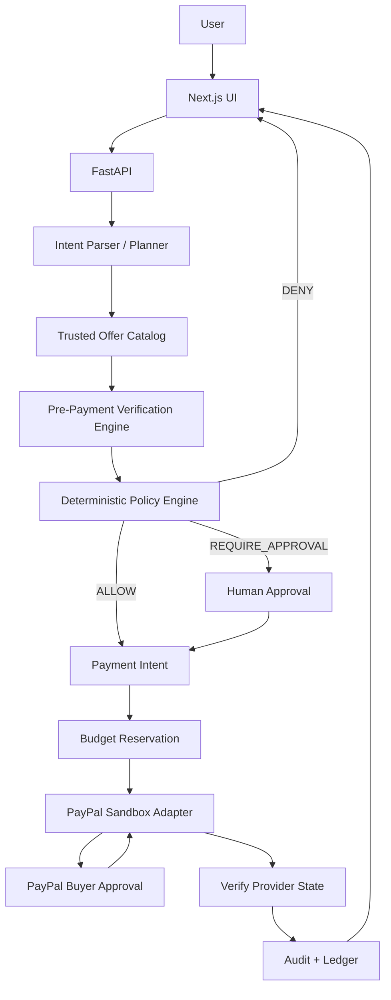

# AgentPay — Codex Build Plan

## 0. Project goal

Build a hackathon-ready MVP for **AgentPay**, a buyer-side agentic commerce system that:

1. accepts a natural-language purchase request,
2. converts it into structured purchase intent,
3. finds/compares candidate offers,
4. verifies that a selected offer matches the user's requirements **before payment**,
5. applies deterministic financial policy,
6. asks for approval when required,
7. executes a supported PayPal Sandbox checkout,
8. records a verifiable audit trail.

### One-line product pitch

> AgentPay doesn't just control how much an AI can spend. It verifies that the AI is buying what the user actually asked for before money is spent.

## 1. Source of truth and scope

This plan preserves the existing AgentPay architecture and adds one flagship refinement: **intent-aware pre-payment verification**.

### Hard scope boundary

- PayPal Sandbox is the real payment integration for the MVP.
- Do not claim the app can directly pay arbitrary merchants.
- Real search APIs are optional; trusted fixture data is acceptable for the demo if clearly labeled.
- The LLM may propose purchases but must never directly execute PayPal capture.
- Buyer authorization required by PayPal remains mandatory.

## 2. Demo scenario

Example request:

> "Find me a hotel in Switzerland for 5 nights under $1,500. Gym and mountain view are mandatory. Free cancellation is required. Private pool is preferred. If the final price is above $1,300, ask me before checkout."

Structured intent:

```json
{
  "category": "hotel",
  "currency": "USD",
  "budget_max": 1500,
  "approval_threshold": 1300,
  "required": {
    "gym": true,
    "mountain_view": true,
    "free_cancellation": true
  },
  "preferred": {
    "private_pool": true
  }
}
```

Expected outcomes:

```text
Hotel A — $1,180
✓ gym
✓ mountain view
✓ free cancellation
✗ private pool
MATCH: 92%
POLICY: ALLOW_ELIGIBLE_FOR_CHECKOUT

Hotel B — $1,390
✓ gym
✓ mountain view
✓ free cancellation
✓ private pool
MATCH: 98%
POLICY: REQUIRE_APPROVAL

Hotel C — $1,620
✓ gym
✓ mountain view
✓ free cancellation
✓ private pool
MATCH: 99%
POLICY: DENY_BUDGET_EXCEEDED
```

The final PayPal transaction should use an AgentPay-controlled Sandbox merchant or compatible demo merchant.

## 3. Core architecture



### Security invariant

```text
LLM -> proposal only
Deterministic backend -> financial authority
Payment adapter -> PayPal calls
```

The LLM cannot:
- change budget limits,
- change merchant identity after approval,
- call PayPal capture,
- override policy,
- invent missing verification evidence,
- mark a payment successful.

## 4. Repository structure

```text
agentpay/
├── AGENTS.md
├── PLAN.md
├── ARCHITECTURE.md
├── TASKS.md
├── README.md
├── .env.example
├── docker-compose.yml
├── frontend/
├── backend/
│   ├── app/
│   │   ├── main.py
│   │   ├── api/
│   │   ├── models/
│   │   ├── schemas/
│   │   ├── services/
│   │   │   ├── intent_parser.py
│   │   │   ├── catalog.py
│   │   │   ├── verifier.py
│   │   │   ├── policy.py
│   │   │   ├── approvals.py
│   │   │   ├── payments.py
│   │   │   └── audit.py
│   │   ├── payments/
│   │   │   └── paypal.py
│   │   └── db/
│   └── tests/
├── fixtures/
│   ├── hotels.json
│   ├── electronics.json
│   └── subscriptions.json
└── docs/
    ├── demo-script.md
    ├── threat-model.md
    └── api-contract.md
```

## 5. Data contracts

### PurchaseIntent
- category
- query
- currency
- budget_max_minor
- approval_threshold_minor
- required_attributes
- preferred_attributes
- quantity
- notes

### Offer
- offer_id
- merchant_id
- title
- amount_minor
- currency
- attributes
- evidence
- source

### VerificationResult
- offer_id
- status: PASS / FAIL / UNKNOWN
- required_checks
- preference_score
- missing_evidence
- explanation

### PolicyDecision
- decision: DENY / REQUIRE_APPROVAL / ALLOW_ELIGIBLE_FOR_CHECKOUT
- reason_codes
- amount_minor
- budget_remaining_minor

### PaymentIntent must bind
- user
- selected offer
- exact merchant
- exact amount
- exact currency
- verification result
- active policy version
- approval state
- stable idempotency key

## 6. Verification engine

Use three kinds of checks.

### A. Deterministic checks
Examples:
- amount <= budget
- exact currency
- required boolean attribute is true
- room dates match
- quantity matches
- seller/merchant allowlisted
- cancellation policy field exists
- requested model/spec matches structured listing

### B. Evidence-backed semantic checks
Use an LLM only when natural-language evidence must be interpreted.

The model must return:
- matched requirement
- supporting evidence
- confidence
- UNKNOWN if evidence is insufficient

### C. Human review
Require review when:
- evidence is ambiguous,
- price is above approval threshold,
- merchant is new,
- request is subjective,
- verification confidence is below threshold.

## 7. Policy engine

Policy is deterministic backend code.

Rules:
1. Deny if offer exceeds maximum budget.
2. Deny if currency differs from allowed currency.
3. Deny if any mandatory requirement has FAIL.
4. Require approval if any mandatory requirement is UNKNOWN.
5. Require approval if amount > approval threshold.
6. Require approval if merchant is not allowlisted.
7. Deny duplicate payment attempts for the same approved proposal.
8. Never reuse expired approval.
9. Re-verify offer digest immediately before checkout.
10. Reserve budget atomically before irreversible payment action.

Reason codes:
- BUDGET_EXCEEDED
- REQUIRED_ATTRIBUTE_FAILED
- MISSING_EVIDENCE
- APPROVAL_THRESHOLD_EXCEEDED
- MERCHANT_REVIEW_REQUIRED
- DUPLICATE_ATTEMPT
- APPROVAL_EXPIRED
- PROPOSAL_CHANGED

## 8. PayPal integration

Use:
- PayPal Sandbox
- Orders API v2
- PayPal JavaScript SDK
- backend create/capture calls
- provider-state verification

Flow:

```text
validated proposal
-> create internal payment intent
-> create PayPal order
-> buyer approves in PayPal UI
-> backend revalidates proposal + policy
-> reserve budget
-> capture
-> verify provider response/state
-> post audit + ledger entry
```

Never:
- store PayPal secret in frontend,
- let the LLM call PayPal directly,
- trust amount received from browser,
- retry capture blindly after timeout,
- display paid before provider-confirmed success.

## 9. Database MVP

Minimum tables:
- users
- merchants
- offers
- purchase_intents
- purchase_proposals
- verification_results
- policies
- policy_versions
- budgets
- budget_reservations
- approval_requests
- payment_intents
- payment_attempts
- audit_events

## 10. API MVP

```text
POST /v1/agent/parse
POST /v1/offers/search
POST /v1/proposals
GET  /v1/proposals/{id}
POST /v1/proposals/{id}/verify
POST /v1/proposals/{id}/policy
POST /v1/approvals/{id}/decision
POST /v1/paypal/orders
POST /v1/paypal/orders/{id}/capture
GET  /v1/payment-intents/{id}
GET  /v1/audit-events
```

## 11. Frontend MVP

Required screens:
1. Command screen
2. Shortlist
3. Verification detail
4. Approval screen
5. PayPal checkout
6. Result / audit

## 12. Implementation phases

### Phase 0 — Scaffold
Done when:
- frontend boots
- backend boots
- Docker Compose works
- health endpoint works
- .env.example committed
- no secrets

### Phase 1 — Intent parsing
- PurchaseIntent schema
- LLM structured output
- validation
- 15 fixture prompts

### Phase 2 — Offer catalog
- trusted fixture data
- hotel offers
- search/filter endpoint
- merchant IDs
- evidence fields

### Phase 3 — Verification
- required checks
- preferred scoring
- evidence capture
- PASS / FAIL / UNKNOWN

### Phase 4 — Policy
- hard budget ceiling
- approval threshold
- merchant policy
- duplicate check
- proposal digest

### Phase 5 — PayPal Sandbox
- OAuth
- create order
- buyer approval
- capture
- provider-state verification
- idempotency

### Phase 6 — Audit + UX
- audit timeline
- approval history
- verification snapshot
- polished result cards

### Phase 7 — Adversarial testing
- malicious listing prompt injection
- changed price after approval
- changed merchant
- duplicate request
- expired approval
- concurrent requests
- provider timeout
- buyer declines

### Phase 8 — Demo freeze
Demo must show:
1. natural-language request
2. three offers
3. verification
4. one approval escalation
5. real PayPal Sandbox checkout
6. one blocked unsafe attempt
7. audit explanation

## 13. Codex execution strategy

Do NOT ask Codex to build the whole project in one task.

Recommended sequence:
1. scaffold backend/frontend
2. define schemas
3. fixture catalog
4. deterministic verifier
5. intent parser
6. policy service
7. proposal digest + approvals
8. payment state machine
9. PayPal adapter
10. frontend shortlist
11. approval UI
12. PayPal UI
13. audit timeline
14. tests
15. security review
16. demo polish

After every 2–3 tasks:
- run tests
- inspect diff
- commit
- ask reviewer agent to check security assumptions

## 14. Definition of done

- [ ] request converts to typed intent
- [ ] 3 offers are returned
- [ ] required vs preferred constraints are visible
- [ ] verification has source evidence
- [ ] policy returns ALLOW / ASK / DENY deterministically
- [ ] user cannot override hard budget through prompting
- [ ] final merchant/amount is bound to approved proposal
- [ ] PayPal Sandbox checkout works
- [ ] payment status is verified server-side
- [ ] duplicate payment attempt is blocked
- [ ] audit trail explains the entire decision
- [ ] no production credentials are in repo
- [ ] README contains startup instructions
- [ ] demo is reproducible
