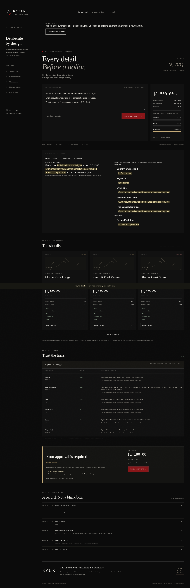

# Ryuk

Turn a purchase request into an evidence-backed proposal, review its exact terms, and authorize a PayPal Sandbox checkout.



*Isolated test-fixture screenshot: fake intent parser and synthetic inventory. No live model, PayPal checkout, purchase, booking or payment evidence.*

## Quick start — current checkout

Requires Git, Docker Engine with BuildKit and Compose v2. From the repository root, run the first command only if `.env` does not exist. Then configure the private file using the [startup guide](docs/startup.md), including the selected model provider, Sandbox seller, demo session and proxy secret. Preserve existing configuration and finish/reconcile active purchases before restarting services.

```sh
cp -n .env.example .env
# Configure .env privately before continuing; never commit or share it.
docker compose --env-file .env up -d --build --wait backend frontend ingress
docker compose ps
```

Open **http://localhost:3000** and unlock the workspace. These three commands use your current checkout; they do not select a release tag, reset the budget or prove provider readiness. For a pinned release or an existing ledger, follow the [update/backup instructions](docs/startup.md) first. The presentation/source-quote updates are on main; the published tag named below remains an earlier freeze.

**Honest scope:** private single-buyer demo, synthetic hotel inventory and PayPal Sandbox only. No real funds move and no hotel is booked. The model proposes; the deterministic backend authorizes, and every model-derived purchase requires human intent review plus separate PayPal buyer approval. A quote is not proof of semantic completeness. Production identity/operations work and measured live acceptance remain outside the automated test evidence. See [release limitations](docs/release-notes.md) and [demo walkthrough](docs/demo-script.md).

Architecture: [implemented flow, trust boundary and spending invariant](docs/architecture-demo.md).

## Implementation and evidence

**AI can choose. You stay in control.** Ryuk is a dark casebook for intent-aware commerce: typed intent, synthetic hotel shortlist, evidence verification, deterministic policy, exact approval and backend-confirmed PayPal Sandbox checkout. The frontend is integrated with the existing services through a same-origin proxy and an opt-in password-protected single-buyer session. SQLite persists execution, budget holds and checkout audit; canonical proposals/approvals and early audit now persist in SQLite. See [durable authority and recovery](docs/durable-authority.md).

**Private Sandbox prerelease: `v0.1.1-sandbox-demo`.** Start with the [startup guide](docs/startup.md), [three-minute walkthrough](docs/demo-script.md) and [release evidence/limitations](docs/release-notes.md). The user reports a completed local website payment with a passing receipt export; a measured live three-minute run remains pending. This is synthetic inventory, not hotel booking or production payments.

See [STATUS.md](STATUS.md) for verified progress, [PLAN.md](PLAN.md) for scope, [DECISIONS.md](DECISIONS.md) for decisions, and [domain schemas](docs/domain-schemas.md) for contracts and validation rules. See [catalog documentation](docs/catalog.md) for the eight synthetic offers and search endpoint, and [verification documentation](docs/verification.md) for mandatory/preferred checks and snapshot semantics. [Intent parser documentation](docs/intent-parser.md) covers provider configuration, source validation, and the 15 synthetic prompt cases. [Financial policy documentation](docs/policy.md) describes authority inputs, decisions, reason codes, and the boundary with future transaction controls. [Proposal binding and approvals](docs/approvals.md) documents exact hashes, expiry, invalidation, replay handling, and the in-memory reference store. [Payment state machine](docs/payment-state-machine.md) lists legal events, terminal locks, uncertainty rules, and integration boundaries.

## Docker Compose

Requires Docker Engine with BuildKit and Docker Compose v2.

```sh
# Preserve any existing private .env; otherwise copy the template.
cp -n .env.example .env
# Configure private demo/provider settings as described in docs/frontend.md.
docker compose --env-file .env up --build -d --wait
curl --fail http://localhost:8000/health
# Expected: {"status":"ok"}
```

Open http://localhost:3000 for the Ryuk casebook and http://localhost:8000/docs for API documentation. Ports are published on loopback only. `/health` asserts process liveness, not database or provider readiness. Both containers have health checks and run as non-root users. Health and catalog startup need no credentials; intent parsing needs the selected backend Groq or OpenAI configuration.

```sh
docker compose logs -f
docker compose down
```

SQLite checkout/hold/audit persistence uses the protected Compose volume; no separate database service is required. Canonical proposals/approvals now persist with their bound consent state. The backend loads labeled `fixtures/hotels.json` and the integrated frontend uses the same-origin API proxy. Compose runs the production frontend build; use the local workflow below for hot reload.

### Builds behind a TLS-inspecting proxy

Keep Docker's configured proxy settings. Both Dockerfiles accept an optional BuildKit secret named `proxy_ca`; this is only a public CA bundle, never an API credential. On a managed cloud environment, create an override **outside the repository** with:

```yaml
services:
  backend:
    build:
      secrets: [proxy_ca]
  frontend:
    build:
      secrets: [proxy_ca]
secrets:
  proxy_ca:
    file: /etc/ssl/certs/ca-certificates.crt
```

Then run `docker compose -f docker-compose.yml -f /path/to/override.yml up --build -d --wait`. Set the file path to the proxy-trusted CA bundle on the host. The CA is mounted only during dependency installation and is not copied into the image. Normal builds require no override.

## Local development

Requires Node.js 22+ (tested with 24), npm, and Python 3.12. Dependencies are recorded in `frontend/package-lock.json` and pinned backend requirements files.

Backend, in one terminal:

```sh
cd backend
python -m venv .venv
. .venv/bin/activate
python -m pip install -r requirements-dev.txt
uvicorn app.main:app --host 127.0.0.1 --port 8000 --reload --no-proxy-headers
```

Frontend, in another terminal:

```sh
cd frontend
npm ci
npm run dev
```

Visit http://localhost:3000. To test the production frontend locally, use the standalone build/start commands in [operations](docs/operations.md). Stop Compose first if using the same ports.

## Checks

```sh
# From backend/
.venv/bin/ruff check .
.venv/bin/pytest -q
.venv/bin/pip check

# From frontend/
npm run lint
npm run typecheck
npm run build

# From repository root, with services running
curl --fail http://localhost:8000/health
curl --fail --output /dev/null http://localhost:3000

docker compose config --quiet
```

Backend tests cover domain validation, fixture integrity, catalog filtering/isolation, deterministic verification/preferences, snapshot identity, deterministic financial policy, canonical hashing, approval lifecycle/expiry/replay/concurrency checks, exhaustive payment transitions and uncertainty paths, intent parsing through the fake and real SDK with mock HTTP, and HTTP health/search/parse contracts without external services. Checkout service/API integration tests now cover reservations, binding revalidation, duplicate execution, concurrency and restart recovery with mocked provider HTTP. The browser suite exercises the production UI/proxy/backend with mocked provider/model, and the security review records confirmed fixes and remaining risks. These do not certify production readiness or timed live acceptance.

## Configuration and secrets

Use `.env.example` as the canonical template; `env.example` is the original planning template retained for reference. `.env` and local environment variants are ignored by Git and excluded from image build contexts. Never put real credentials into either example.

Compose passes selected Groq/OpenAI and private PayPal settings only to the backend. Configure LLM_PROVIDER with its matching key/model in the ignored root `.env`; direct local Python processes need those settings exported separately. DATABASE_URL is unused; SQLite uses RYUK_CHECKOUT_DB_PATH. The authenticated UI receives only PayPal's public client ID, never the secret. Legacy NEXT_PUBLIC template values are not needed by this UI. See [parser configuration](docs/intent-parser.md) and [PayPal configuration/recovery](docs/paypal.md).

[Checkout integration](docs/checkout.md) documents the durable ledger, pre-capture revalidation/reservation, recovery and identifier-only API. Private checkout is now provisioned only when explicitly enabled with a backend password and supported Sandbox settings; missing configuration stays blocked. Constant browser identities and test payment fallbacks are not enabled. Durable canonical authority/recovery is implemented; multi-user production auth and full migrations/provisioning remain pending.

## Verified security and demo preparation

See [security review](docs/security-review.md), [operator backup/recovery](docs/operations.md) and [demo acceptance](docs/demo-script.md). Every model-derived purchase requires application review of the original and parsed request before PayPal buyer approval, including below-threshold offers. Digest v2 binds that review; it does not establish semantic completeness. Groq is available with backend-only LLM_PROVIDER=groq/GROQ_API_KEY/GROQ_MODEL; default OpenAI remains supported. Configure the selected provider privately; both use strict output and the same source/domain checks.

Latest local automated checks: **1,114 backend tests**, **25 frontend helper tests**, frontend lint/typecheck/production build and **98 mocked browser assertions**. These checks cover the presentation/provenance updates on main; the published tag remains an earlier freeze. User reports local revision 0b24df8 with healthy rebuilt containers and checks_passed=true on the website payment receipt. That receipt remains private; timed live acceptance and production gaps remain open. See the release notes for evidence provenance and residual security limits.

Login throttling uses the authenticated ingress client address, not the shared Next proxy IP. Configure the backend-only RYUK_PROXY_SHARED_SECRET and read [login proxy setup and limits](docs/login-rate-limits.md) before rebuilding all three Compose services.

Document scripts now use a nonce-based CSP with PayPal nonce propagation; HTML is dynamically rendered and must not be shared-cached. See [policy and live-SDK validation limits](docs/content-security-policy.md).

## License

Ryuk is available under the [MIT License](LICENSE). Third-party dependencies retain their respective licenses.
