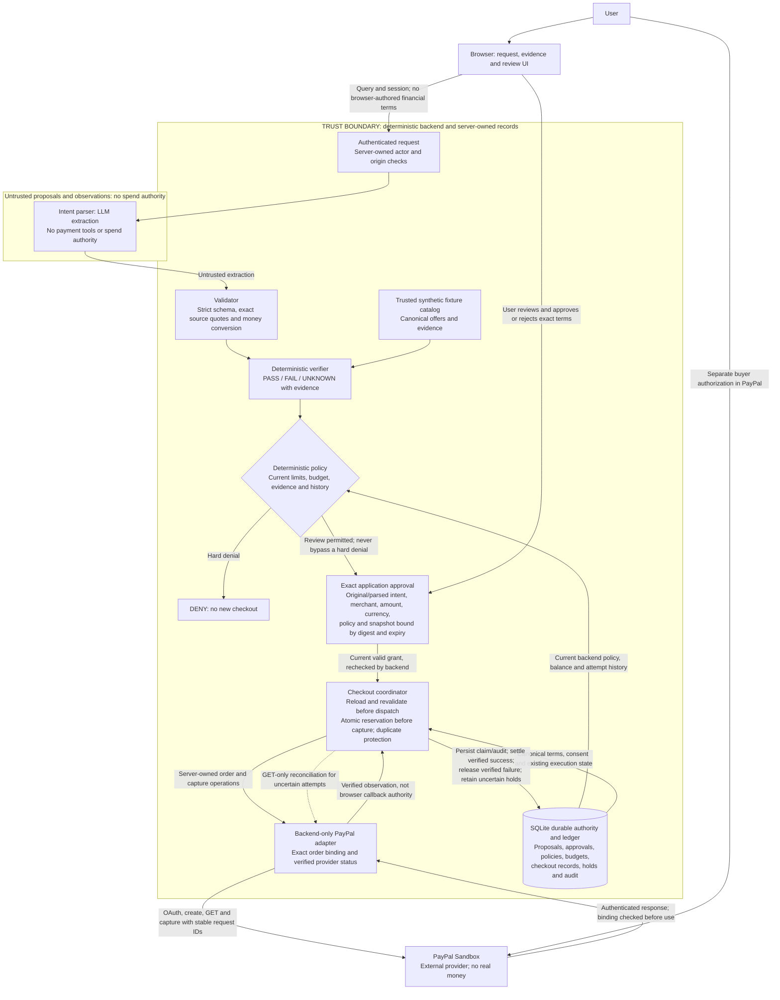

# Ryuk demo architecture and trust boundary

**The LLM proposes; only the deterministic backend authorizes spending.**

This diagram describes the implemented model-derived purchase path in the current checkout. It is a private, single-buyer PayPal Sandbox demo with synthetic inventory, not production identity, real hotel booking or live-money acceptance.

## How to read the boundary

- The browser submits query text, identifiers and review decisions. It cannot choose authoritative prices, merchants, balances, financial identity or payment success. The ingress/Next proxy transports requests; backend session/origin/ownership checks still apply.
- The LLM extracts a proposed intent. Backend code validates its closed schema, source quotes, currencies and integer minor-unit money before using it. Retained requirement-source links help the buyer inspect the interpretation; quoted text does not prove semantic completeness.
- Retrieval uses the labeled local synthetic catalog. The verifier checks mandatory/preferred attributes against recorded evidence; the policy computes DENY, REQUIRE_APPROVAL or eligibility. There is no implemented Google search, supplier booking or model-controlled policy override in this path.
- Every model-derived purchase requires exact application review, including below-threshold offers. A grant cannot override a hard denial. This diagram focuses on that model-derived path; trusted internal eligible-proposal test cases do not remove the UI review requirement.
- Application consent and PayPal buyer authorization are separate gates. The coordinator reloads canonical terms, current policy/budget, approval and digest, then atomically reserves/claims before capture. Provider network I/O stays outside database transactions.
- Only backend-verified provider observations change the ledger. A callback, HTTP 200 or completed-looking browser screen alone is not payment confirmation. Ambiguity keeps the hold and uses GET-only reconciliation; no blind capture retry. A recorded, narrowly validated decline still requires a bound provider recheck before release.
- Durable proposals/approvals, early audit and checkout state survive restart; sessions require a fresh login. Legacy missing consent is not reconstructed. The database and private backups remain a trusted operator boundary, not protection against an operator who can rewrite them.

The arrows summarize logical responsibilities, not a single distributed transaction. Canonical state, claims, provider observations and settlement are persisted at their existing boundaries; no provider call is made while holding a ledger transaction.

## Implementation references

| Responsibility | Existing implementation |
| --- | --- |
| Authenticated request and browser seams | [workspace API](../backend/app/api/workspace.py), [session checks](../backend/app/services/session.py), [Next proxy](../frontend/app/api/ryuk/[...path]/route.ts) |
| Model extraction and domain validation | [intent parser](../backend/app/services/intent_parser.py), [domain contracts](../backend/app/schemas/domain.py) |
| Synthetic retrieval and evidence | [catalog](../backend/app/services/catalog.py), [verifier](../backend/app/services/verifier.py) |
| Deterministic decisions and exact consent | [policy](../backend/app/services/policy.py), [approval rules](../backend/app/services/approvals.py), [proposal binding](../backend/app/services/proposal_binding.py) |
| Durable authority and execution | [durable approvals](../backend/app/services/durable_approvals.py), [checkout coordinator](../backend/app/services/checkout.py), [SQLite store](../backend/app/services/checkout_store.py) |
| External Sandbox integration | [PayPal adapter](../backend/app/services/paypal.py), [recovery boundaries](operator-recovery.md) |

Remaining production limitations are in [release notes](release-notes.md) and [security review](security-review.md). This diagram does not claim a measured live three-minute run, real inventory, fulfillment, production multi-user authentication or live-money readiness.
